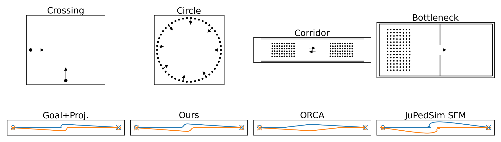
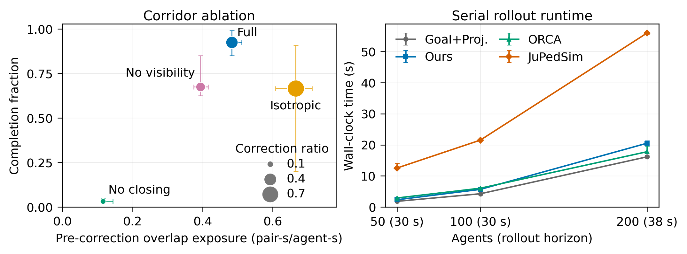

# Agent-Induced Riemannian Metric Fields for Crowd Simulation

**[Derek You](https://github.com/dh-you)**  
Independent, Edison, NJ, USA &nbsp;&middot;&nbsp; `derekyou65@gmail.com`

**European Conference on Multi-Agent Systems (EUMAS 2026) &middot; Springer LNAI 16829, pp. 715–720**

[](https://doi.org/10.1007/978-3-032-39395-1_42)
[](https://dh-you.github.io/riemannian-crowd-sim/)
[](https://github.com/dh-you/riemannian-crowd-sim/releases/tag/paper-eumas-2026-v1.0)
[](https://dh-you.github.io/riemannian-crowd-sim/pages/demo.html)

<p align="center">
  
</p>

## Abstract

Microscopic crowd controllers often encode avoidance either by adding repulsive interactions to goal-directed motion or by selecting a velocity from a collision-free set. In additive force and potential formulations, goal progress and avoidance can directly oppose one another, contributing to local minima, oscillation, and counterproductive reversals of motion. We propose instead an anisotropic Riemannian steering law in which nearby agents induce a local positive-definite metric and the commanded velocity is inverse-metric descent of an unchanged goal potential. This separates the navigation objective from the local descent geometry: the goal specifies where the agent should go, while the metric specifies which nearby directions have become costly. As a result, the commanded motion is uniquely defined, speed-bounded, and strictly decreases the goal potential. Held-out experiments show zero median pairwise penetration and completion of .84 and 1.00 in the dense corridor and bottleneck, respectively, compared with .61/.73 for ORCA and .47/.86 for JuPedSim.

## Held-Out Experimental Results (Table 1)

Medians across held-out instances ($T / T_0$ is conditional on completion; $E_{\mathrm{ov}}$ is in pair-seconds per agent-second and $P_{\max}$ in metres; lower is better except completion):

| Scenario | Method | Comp. $\uparrow$ | $T / T_0 \downarrow$ | $E_{\mathrm{ov}} \downarrow$ | $P_{\max} \downarrow$ | RMS acc. $\downarrow$ |
|---|---|---:|---:|---:|---:|---:|
| **Head-on** | **Ours** | **1.000** | 1.05 | **.000** | **.000** | 2.48 |
| | Goal+Proj. | 1.000 | 1.05 | .008 | .034 | 3.99 |
| | ORCA | 1.000 | 1.00 | .000 | .000 | 2.41 |
| | JuPedSim SFM | 1.000 | 1.17 | <.001 | .001 | 2.34 |
| **Crossing** | **Ours** | **1.000** | 1.07 | **.000** | **.000** | 2.40 |
| | Goal+Proj. | 1.000 | 1.02 | .008 | .022 | 3.32 |
| | ORCA | 1.000 | 1.01 | .000 | .000 | 2.46 |
| | JuPedSim SFM | 1.000 | 1.07 | .000 | .000 | 1.35 |
| **Circle** | **Ours** | **1.000** | 1.84 | .410 | .062 | 2.79 |
| | Goal+Proj. | 1.000 | 1.96 | .530 | .081 | 3.37 |
| | ORCA | 1.000 | 1.59 | .025 | .006 | 2.52 |
| | JuPedSim SFM | .960 | 2.58 | <.001 | .034 | 2.04 |
| **Corridor** | **Ours** | **.842** | 1.52 | .485 | .082 | 2.52 |
| | Goal+Proj. | .996 | 1.27 | .599 | .100 | 4.02 |
| | ORCA | .608 | 1.41 | .145 | .019 | .84 |
| | JuPedSim SFM | .471 | 1.62 | <.001 | .018 | 1.97 |
| **Bottleneck** | **Ours** | **1.000** | 1.52 | .922 | .091 | 3.49 |
| | Goal+Proj. | 1.000 | 1.17 | 1.080 | .114 | 4.42 |
| | ORCA | .732 | 1.46 | .253 | .004 | .86 |
| | JuPedSim SFM | .862 | 1.36 | <.001 | .022 | 2.38 |

<p align="center">
  
</p>

## Quick Start

Run the interactive browser demo locally:

```sh
npm ci
npm run dev
```

Run tests and experiments:

```sh
npm test
npm run exp:generate -- --suite experiments/suites/smoke-v1.json --out results/generated-smoke
npm run exp:run -- --scenario experiments/scenarios/pairwise-offset.json --method experiments/methods/riemannian-default.json --out results/pairwise-riemannian
npm run exp:aggregate -- --input results/batch --out results/aggregate
```

## Repository Layout

| Path | Purpose |
|---|---|
| `src/core/` | Anisotropic Riemannian & Euclidean goal-projection controllers, deterministic simulation, positional correction |
| `src/demo/`, `pages/` | Interactive Three.js / WebGL crowd scenarios |
| `experiments/` | Scenario generation, engines, and run/batch/aggregate CLI |
| `docs/` | [Scientific core equations](docs/scientific-core.md) and [experiment protocol](docs/experiment-protocol.md) |
| `tests/` | Core controller, determinism, and experiment-protocol test suite |
| `index.html`, `public/static/` | Academic project page |

`main` provides the TypeScript Riemannian and Euclidean goal-projection controllers and interactive WebGL demos. The full multi-baseline comparison bundle (including native ORCA/RVO2 and JuPedSim 1.4.2 SocialForceModel runners, run-level records, IQRs, and SHA-256 provenance manifests) is archived at the [EUMAS 2026 Evidence Release (`paper-eumas-2026-v1.0`)](https://github.com/dh-you/riemannian-crowd-sim/releases/tag/paper-eumas-2026-v1.0).

## Citation

```bibtex
@inproceedings{you2026riemannian,
  author={You, Derek},
  editor={Lorig, Fabian and others},
  title={Agent-Induced {R}iemannian Metric Fields for Crowd Simulation},
  booktitle={Multi-Agent Systems -- EUMAS 2026},
  series={Lecture Notes in Computer Science},
  volume={16829},
  pages={715--720},
  year={2027},
  publisher={Springer Nature Switzerland},
  doi={10.1007/978-3-032-39395-1_42},
  url={https://doi.org/10.1007/978-3-032-39395-1_42}
}
```
